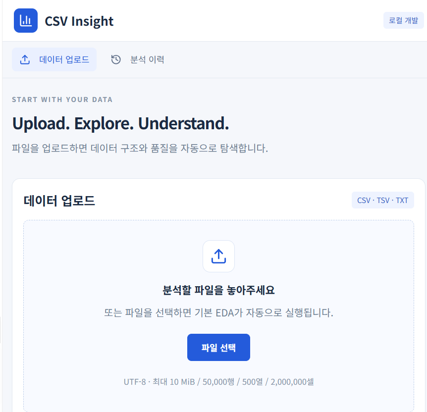

# CSV Insight · Auto EDA

첨부 `Auto_EDA_WebApp_SPEC.md`를 기준으로 구축한 별도 React/Vite/TypeScript 앱입니다. 기존 `csv-insight` Sites 앱과 분리됩니다. 분석은 Hono/Node 서버가 수행하고, 화면은 React와 Apache ECharts로 표시합니다.

## 현재 실행하기

작업 폴더에서 PowerShell을 열고 아래 명령을 실행합니다. 처음 설치 후 두 터미널을 사용하세요.

```powershell
npm install
Copy-Item .env.example .env.local
npm run seed:samples
```

```powershell
# 터미널 1: 분석 API
npm run dev:api
```

```powershell
# 터미널 2: 화면
npm run dev:web
```

브라우저: **http://127.0.0.1:5173**. API: http://127.0.0.1:3002/api/v1/health.

`npm run dev`도 두 서버를 동시에 실행합니다. 폴더 이름에 세미콜론이 포함된 Windows 환경에서도 실행되도록 npm 스크립트는 Node 진입점의 경로를 직접 사용합니다. Node 22 이상이 필요하며 이 작업은 Node 24.18.0에서 검증했습니다. 설치 버전은 `package-lock.json`에 고정되어 있습니다.

새 체크아웃에서는 `.env.local`을 직접 생성하세요. 샘플 원본은 저장소에 포함하지 않으므로 `samples/manifest.json`의 sourcePath 위치에 파일을 준비한 경우에만 seed 명령을 실행합니다. 샘플 없이도 사용자 파일 업로드와 분석이 가능합니다. 기본 일 분석 제한은 20회입니다.

### 로컬 데이터의 위치

- `.local/objects/`: 업로드 원본, 정규화 자료, 결과, 다운로드 파일과 비공개 seed.
- `.local/state.json`: 데이터셋과 분석 이력. 새로고침 또는 서버 재시작 후에도 유지됩니다.
- `samples/manifest.json`: 원본 SHA-256, 파일 크기, 파서, 변수 역할, 기본 타깃/그룹, 출처와 이용 조건. 원본 내용은 포함하지 않습니다.
- 제공한 CSV는 공개 `public/` 또는 웹 번들에 복사하지 않습니다. 로컬 서버는 `127.0.0.1`에만 바인딩합니다.

로컬 개발 모드는 로그인과 Neon 없이 기능을 검증하기 위한 단일 사용자 모드입니다. **온라인 인증·Neon을 구현한 것으로 대체 표시하지 않습니다.** `APP_MODE=local`은 Vercel 또는 `NODE_ENV=production`에서 무시됩니다. 프런트엔드의 로그인 생략도 개발 서버에서만 허용됩니다.

## 구현된 기능

- CSV/TSV/숫자 공백 TXT 업로드와 구분자·헤더·결측 토큰 설정. quoted CSV, 내부 줄바꿈, BOM 지원.
- 10 MiB / 50,000행 / 500열 / 2,000,000셀 / 셀당 10,000자 제한. 초과 파일은 일부 결과를 전체 결과처럼 표시하지 않고 거부.
- 숫자형(95% 규칙), 0/1 이진형, 범주형, ISO 날짜 후보, 텍스트 및 명시적 순서형. 변환 실패와 결측을 분리.
- 행열 개요, 가상 스크롤 미리보기(10/25/50/100행, 30열), 페이지별 열 프로파일과 유형 재설정.
- 사용자 타깃·그룹·제외 열·행렬 열·산점도 X 선택, 파서 수정과 버전 확인, 재분석.
- 표본 표준편차, 선형 보간 분위수, IQR 이상치 후보, 중복/상수/동일 열/낮은 분산/고유값이 많은 범주 점검.
- Pearson·동점 평균 순위 Spearman, 유효 n·제외 행, 최대 30열 상관행렬, seed 42의 최대 2,000행 산점도.
- 범주 타깃은 빈도·클래스별 분포·교차 빈도 분석. 범주를 임의 번호로 변환해 상관을 계산하지 않음.
- 와인 순서형 점수, 종류별 상관, 점수별 알코올 상자그림, 원본/중복 제거 비교.
- 해군함정 두 상태계수, 선속 평균 제거 전후 상관, 고정 선속 산점도, 연료 유량 히트맵과 실제 관측 조합의 정상/열화 비교.
- 이력 저장·재조회·분석 삭제·원본 포함 삭제, JSON/통계 CSV/차트 PNG 다운로드, CSV 수식 방어.
- 한국어 규칙 기반 인사이트, 차트의 통계 표 대체 표현, 반응형 화면, 외부 AI 호출 없음.
- 클라우드 연결 코드: Clerk 서버 세션 검증, Neon 원자적 실행 lease·일 제한·트랜잭션 저장, private Blob 직접 업로드와 소유자 검사.

MVP에서 XLSX, PDF, 일반 다중 파일 조인, 모델 학습, 잔여 수명 예측, OpenAI 해설을 제공하지 않습니다. AI endpoint는 소유권 확인 후 `501 FEATURE_DISABLED`를 반환합니다.

## 브라우저 분석 이력과 자동 저장

IndexedDB에 전체 데이터셋, 분석 결과(열 프로파일·차트 포함), 분석 설정을 저장합니다. 분석 이력 화면에서 이전 결과를 다시 열거나 브라우저 저장본을 삭제할 수 있습니다. 새 분석은 기존 결과를 덮어쓰지 않습니다.

- 마지막 사용 시각 기준 최근 5개를 유지하며, 7일이 지나면 만료됩니다. 결과 열기와 설정 저장 시 사용 시각을 갱신합니다.
- 타깃·분석 행 범위·그룹 변수와 그룹 값 필터·기타 분석 조건을 자동 저장합니다. 결과 계산은 조건 적용 및 재분석 버튼으로 실행합니다.
- 새로고침 뒤에도 설정과 결과를 복원합니다. 저장 중·저장 완료·저장 실패와 재시도 버튼을 제공합니다.
- 그룹 값 필터는 줄마다 정확한 값 한 개를 입력합니다. 빈 필터는 전체 그룹, 결측 그룹은 `결측`입니다. 행 범위는 원본 기준 1부터 시작하며 마지막 행을 포함합니다.
- 로컬과 로그인 사용자별 저장 공간을 분리합니다. 공유 컴퓨터에서는 사용 후 브라우저 이력을 삭제하세요.
- 서버 이력과 브라우저 이력은 별도입니다. 5개 제한·만료·브라우저 이력 삭제는 서버 원본을 삭제하지 않습니다. 브라우저 데이터 삭제·비공개 모드·저장 공간 제한에 따라 보관이 중단될 수 있습니다.

`npm test`로 만료 경계·최근 5개·사용 시각 갱신·필터 계산을 검증합니다. `node scripts/history-smoke.mjs`는 실제 IndexedDB 저장·새로고침·이전 결과 유지·서버 연결 없이 결과/차트 복원·만료·삭제를 검증합니다.

## 이번 작업의 주요 변경 및 오류 수정

React/Vite 화면과 Hono 분석 API를 연결하고, 실제 업로드 데이터에 대한 자동 EDA·시각화·분석 이력·내보내기까지 구현했습니다. 초기 화면에는 임의 분석 결과를 표시하지 않습니다. 서버 분석 방식이므로 업로드 파일은 로컬 실행 시 로컬 API에서, 클라우드 연결 시 인증된 서버에서 처리됩니다.

- **Windows 실행 오류:** 세미콜론이 포함된 작업 경로에서 npm 실행 파일 탐색이 실패하던 문제를 Node 진입점 직접 실행으로 수정했습니다.
- **저장 오류:** Windows 파일 교체의 일시적 EPERM/EACCES/EBUSY 실패에 재시도와 지연을 적용했습니다.
- **CSV 해석:** BOM·따옴표·필드 내부 줄바꿈을 처리하고, 열 개수 불일치와 제한 초과 입력을 명확하게 거부합니다. 내부 열 ID로 빈 헤더와 중복 헤더를 구분합니다.
- **통계 정확성:** 숫자 변환 실패를 결측과 분리하고, `1`, `1.0`, `1e0`을 같은 숫자로 정규화하여 중복 행·상수·동일 열 판정 오류를 수정했습니다.
- **API 연결:** 잘못된 Vercel 어댑터 import를 Node 요청 어댑터로 교체하고, 인증 헤더 타입 오류를 수정했습니다. 화면 포트 5173과 API Origin 설정을 맞췄습니다.
- **화면과 차트:** 타깃 선택 접근성 레이블과 모바일 레이아웃을 보완했습니다. ECharts 모듈별 import로 번들 크기를 줄이고, 차트 tooltip에 HTML 대신 richText를 사용합니다.
- **권한과 파일 처리:** 소유권 검사, 멱등 재분석, 실행 lease, 일별 제한 및 CSV 수식 방어를 구현했습니다. 운영 환경에서는 로컬 로그인 생략이 적용되지 않습니다.

빌드와 21개 테스트, 실제 5개 샘플 회귀 검증을 통과했습니다. 브라우저에서 업로드·분석·이력 복원·재분석·다운로드·삭제 및 모바일 화면을 확인했습니다. 실제 클라우드 서비스 통합 검증은 별도로 필요합니다.

## 실제 데이터 검증

```powershell
npm run build
npm test
npm run verify:samples
# Windows Edge가 설치된 상태에서 두 서버를 실행한 뒤
node scripts/browser-smoke.mjs
```

작은 손계산 fixture·파서·API·소유권 경계·멱등 요청·일 제한·저장/삭제·숫자 표기 정규화 테스트 21개와 실제 5개 샘플 회귀 검증을 수행했습니다. 독립적인 pandas/NumPy 비교, 실제 Neon/Clerk/Blob 통합, 온라인 부하 p50/p95 측정은 아직 수행하지 않았습니다.

| 데이터 | 구조 | 검증한 값 |
|---|---|---|
| 벤츠 | 4,209 × 378 | 범주형 8개, 상수 12개, ID 제외 |
| 해군함정 | 11,934 × 18 | 결측/행 중복 0, T1/P1 상수, Ts/Tp 동일 |
| 해군함정 조건 보정 | 전체 유효 행 | GGn–압축기 계수 Pearson −0.018838 → 선속 평균 제거 후 −0.757668 |
| 해군함정 연료 비교 | 27 knots의 실제 조합 | 정상 1.704 / 최대 열화 1.832 kg/s, +7.511737%, 각각 n=1 |
| 레드 와인 | 1,599 × 12 | 중복 240, alcohol–quality Pearson 0.476166 |
| 화이트 와인 | 4,898 × 12 | 중복 937, alcohol–quality Pearson 0.435575 |
| 통합 와인 | 6,497 × 13 | wine_type 유지, red/white 별도 상관 일치 |

벤츠 약 3.8초, 해군 약 3.2초, 와인 약 0.15–0.5초는 현재 컴퓨터에서의 단일 엔진 검증 관측값입니다. 네트워크·클라우드 cold start·로그인·Neon 지연을 포함하는 서비스 보장 시간이 아닙니다. 검증 결과와 화면 PNG는 `.local/verification/`에 저장됩니다.

## 비공개 온라인 앱 연결 가이드

현재는 비공개 진행이며 **온라인 배포는 실행하지 않았습니다.** 로컬 검증 후 사용자가 직접 Vercel 배포를 진행합니다. Vercel·Neon·Clerk·private Blob 실계정 연결은 아직 검증하지 않았습니다. 아래는 연결 가이드입니다.

### 1. Vercel와 Neon

1. 이 폴더를 별도 Git 저장소로 연결합니다. `.local`, `.env.local`, 원본 샘플과 비밀키는 올리지 않습니다.
2. Vercel에서 프로젝트를 가져오고 Vite, build `npm run build`, output `dist`를 선택합니다. API는 `api/index.ts`의 Node 요청 어댑터입니다. SPA fallback과 `/api/*` rewrite는 `vercel.json`에 있습니다.
3. Neon 프로젝트를 생성하고 Preview와 Production에 별도 branch/DB를 사용합니다. Vercel 서버 실행 region과 가까운 Neon region을 선택합니다.
4. 서버에 `DATABASE_URL`을 설정하고 migration용 최소 권한 연결을 `DATABASE_MIGRATION_URL`에 설정합니다. 클라이언트 환경변수에는 넣지 않습니다.
5. 관리자 환경에서 `npm run db:migrate`를 실행합니다. migration은 빌드나 일반 HTTP 요청에서 자동 실행하지 않습니다.

`drizzle/0001_init.sql`은 app_users, sample_catalog, datasets, dataset_files, dataset_columns, analyses, analysis_results, exports, usage_daily와 인덱스·CHECK·FK를 정의합니다. Drizzle 타입 스키마는 `server/db/schema.ts`에 있고, 런타임 쿼리는 Neon HTTP 태그 SQL 및 transaction API로 바인딩합니다. 원본 셀 전체를 DB JSONB에 넣지 않습니다.

### 2. 로그인과 비공개 파일 저장소

1. Clerk 프로젝트를 생성하고 배포 domain/localhost를 허용합니다. `CLERK_SECRET_KEY`, `CLERK_PUBLISHABLE_KEY`, `VITE_CLERK_PUBLISHABLE_KEY`를 설정합니다.
2. Vercel 프로젝트에서 Blob 저장소를 **Private**으로 생성합니다. `BLOB_READ_WRITE_TOKEN`을 서버에만 설정합니다.
3. 서버 `APP_ORIGIN=https://실제-앱-주소`를 설정합니다. Clerk 세션의 authorized party와 mutation Origin 검사에 사용합니다.
4. 배포 환경은 `APP_MODE=cloud`, `VITE_APP_MODE=cloud`, `ENABLE_AI_SUMMARY=false`입니다. `MAX_*`, `DAILY_ANALYSIS_LIMIT`, `ANALYSIS_TIMEOUT_MS`는 `.env.example`의 기본값을 사용합니다.
5. Preview와 Production의 DB·Blob·Clerk 설정을 분리합니다. `/api/v1/health`의 `configured`만으로 연결 성공을 확정하지 않고 실제 로그인·업로드·분석·다운로드·삭제를 검증합니다.

10 MiB 원본은 API 본문으로 보내지 않습니다. 브라우저가 서버에서 받은 제한 토큰으로 private Blob에 직접 업로드합니다. 서버는 객체 크기·소유 경로를 확인하고 정규화·분석합니다. JSON API 본문은 앱 기준 1 MiB로 제한하고 큰 결과 다운로드는 소유권 검사 후 파일 응답으로 제공합니다.

### 3. 샘플 seed와 공개 이용 조건

- `npm run seed:samples`를 **관리자 환경**에서 실행합니다. 프런트엔드 빌드에서는 실행하지 않습니다. 입력 파일의 상대 위치는 `scripts/seed-samples.ts`와 manifest에 기록되어 있습니다.
- 기존 manifest가 있으면 원본 SHA-256 변경을 거부합니다. 변경 시 데이터·기대값·adapter 버전을 검토하세요.
- 벤츠 원본의 공개 재배포 권한은 미확인입니다. 공개 서비스에서 모든 사용자에게 노출하기 전 출처·권한을 확인해야 합니다.
- 해군함정 동봉 README는 상업적 사용을 금지하고 논문 인용을 요구합니다. 시뮬레이션 자료를 실제 고장·시간축·잔여 수명 기록으로 설명하지 않습니다.
- 와인은 `winequality.names`의 논문 인용과 데이터 이용 조건을 보존합니다.
- 클라우드 seed는 새 벤츠·해군함정 항목을 기본 disabled(enabled=0)로 등록하고 와인만 활성화합니다. 권한과 용도를 확인한 뒤 관리자가 활성화할 수 있습니다. 서버 `sample_catalog.enabled`를 0으로 설정하면 해당 샘플은 목록·선택 API에서 제외됩니다. 공개 서비스는 이용 조건이 확인된 샘플만 enable해야 합니다.

### 4. 비공개 Preview 검증

1. Vercel plan의 `maxDuration=120` 지원과 Node 버전을 확인합니다. 실제 배포에서 API rewrite가 원래 경로를 보존하는지, 잘못된 API 경로가 JSON 404인지 검사합니다.
2. 다른 두 사용자 계정으로 소유권 격리·다운로드·삭제를 검증합니다.
3. 4.5 MB를 넘는 파일은 직접 업로드 경로를 통해 검증합니다. 제한 초과 입력, 요청 재시도, 함수 강제 종료, Blob 삭제 실패를 점검합니다.
4. 실제 20명 수업 부하 및 p50/p95를 측정합니다. 클라우드 서비스를 연결하기 전에는 이를 검증한 것으로 표시하지 않습니다.
5. Preview에 접근 보호 설정을 적용해 검증합니다. Production 전환과 공개 여부는 사용자가 직접 결정합니다. 사용자 자료는 로그인 사용자별 비공개로 유지합니다.

## 정리와 운영

```powershell
# 먼저 삭제 후보 수만 확인
npm run cleanup:orphans
# 24시간 경과한 미참조 users/ 객체만 실제 정리
npm run cleanup:orphans -- --apply
```

공유 seed는 사용자 삭제가 제거하지 않습니다. 데이터셋 삭제는 먼저 deleting으로 접근을 차단하고 파일 정리가 완료되어야 DB 레코드를 삭제합니다. 삭제 실패를 성공으로 표시하지 않습니다. 분석 lease는 125초이고 오래된 running은 다음 조회에서 실패로 정리합니다. 자동 정리 스케줄러는 생성하지 않았습니다. 서비스 백업의 즉시 물리 삭제를 보장하지 않습니다.

## 공식 연결 문서

- [Hono Vercel](https://hono.dev/docs/getting-started/vercel)
- [Vercel Blob private storage](https://vercel.com/docs/vercel-blob/private-storage)
- [Vercel Blob client upload](https://vercel.com/docs/vercel-blob/client-upload)
- [Vercel Function 제한](https://vercel.com/docs/functions/limitations)
- [Clerk 서버 세션 검증](https://clerk.com/docs/reference/backend/authenticate-request)
- [Neon serverless driver](https://github.com/neondatabase/serverless)

## 아직 검증하지 못한 항목

실계정 인증과 외부 DB/저장소, 온라인 배포·routing, 사용자 2명 간 클라우드 권한 E2E, 직접 업로드 callback, 실제 Neon 트랜잭션/제한/lease, 20명 부하, 미완료 upload 자동 회수는 서비스 연결 후 확인해야 합니다. 공개 재배포 권한 미확인 데이터는 공개 seed로 활성화하지 마세요.
